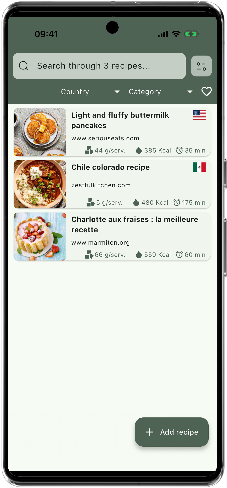
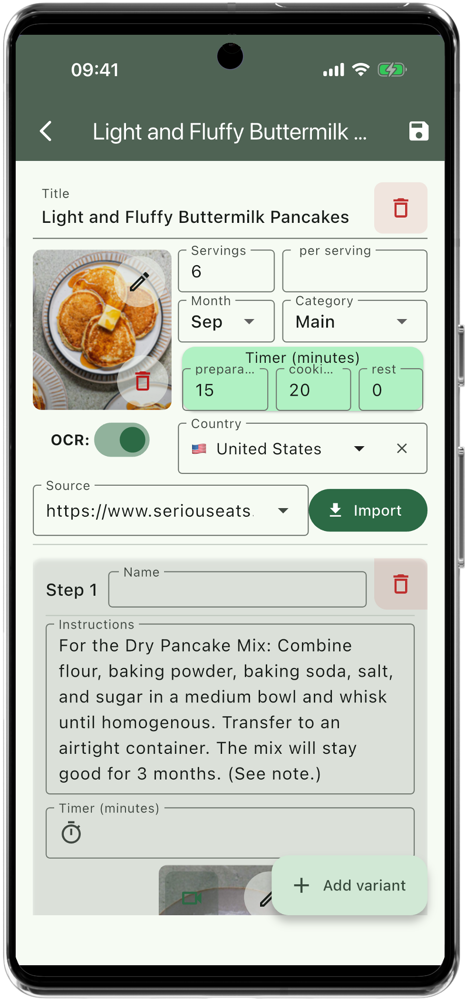
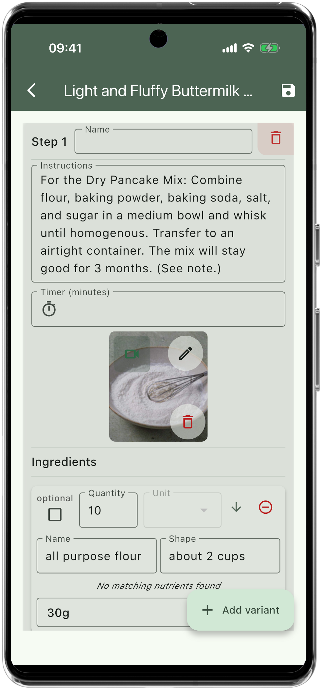
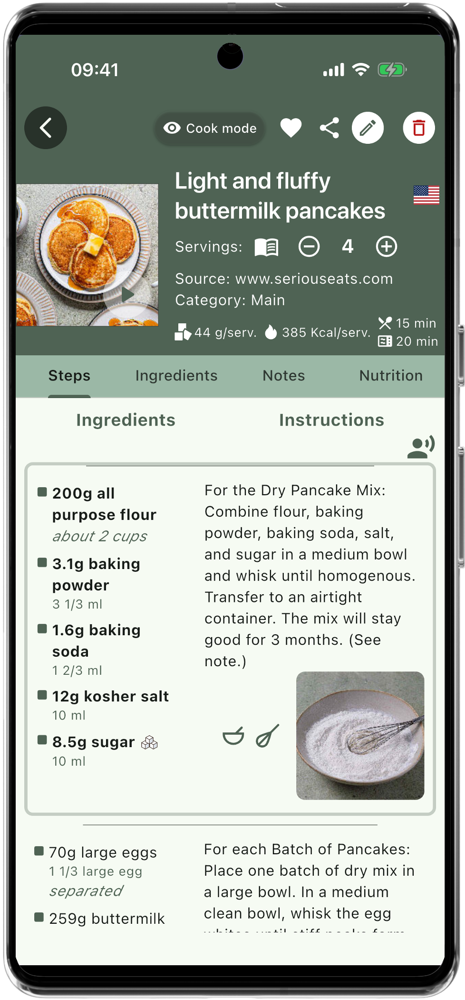
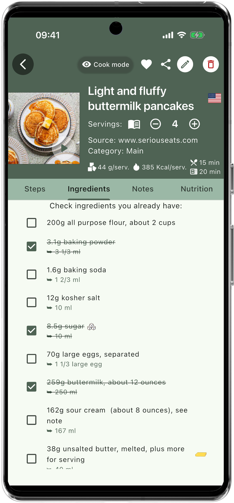
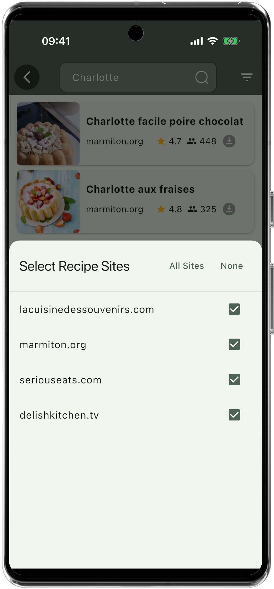
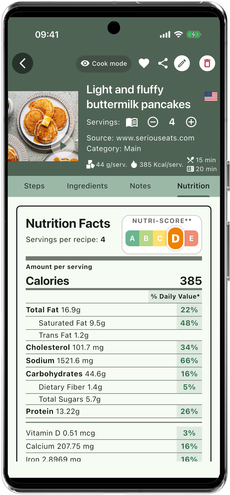

# shefu

Shefu is an **offline**, open source (GPLv3) digital cookbook and kitchen assistant, designed to help you track, organize, and cook your recipes in your native language. All of this with local storage (no internet required!).

<a href='https://play.google.com/store/apps/details?id=fr.orvidia.shefu'>
  <center></center>
</a>

## Key Features:

- **Organize and search your recipes**: Easily add, edit, set as favorite, and search all your recipes with categories (mains, desserts, etc.). **Advanced full-text search**: search 'egg' and you'll find all your recipes including eggs, even meringue! **Multi-term search**: Click on favorites, select Japan in country dropdown and search for "beef,rice" to list all your favorite japanese recipes containing beef and rice, including gyudon/牛丼!

- **Clear step-by-step view**: Follow recipes with easy-to-read steps (ingredients + directions). Add image and optional timer to each individual step. Temperatures are automatically highlighted, required kitchen tool are also automatically set from directions. **Dark mode** available application-wide.

- **Cooking glossary**: Technical terms in recipe steps ("blanchir", "deglaze"...) are underlined with a "?": tap one to read its definition.

- **Interactive recipes**: Tap to highlight current step. Click on "**Cook mode**" to keep the screen awake while you cook. Select desired servings and the ingredients quantities are automatically scaled. Tap on **automically detected timer** to start it, on each step.

- **Offline text to speech**: let the application speak the steps for you, while you are busy cooking. *(Note: this might not work on all devices)*

- **Scan recipes with OCR**: Have a recipe in a book or magazine? Just snap a photo! Shefu's **built-in OCR** (Optical Character Recognition), extracts the title, ingredients, and steps. *(Note: OCR performs best with clear, well-structured text layouts. It uses Google ML Kit on Android and Apple Vision on iPhone, and is not available in the F-Droid version, ML Kit not being free software)*

- **Nutrient tracking & insights, auto Nutri-score**: Link your ingredients to the included **offline nutrient database** (Source: Santé Canada) Foods and factors. Shefu then **automatically** calculates all nutritional values per serving based on your ingredients and specified serving size, and estimates the recipe's **Nutri-Score (2023 updated algorithm)**, helping you make more informed dietary choices. Refer to nutrition tab on recipes. *(Note: this feature is **only available in English and French**)*

- **Shopping list**: Automatically generate and maintain a checkable shopping list for ingredients you lack to prepare your selected recipes.

- **Multi-language support**: Fully available in English🇺🇸, French/Français🇫🇷, Japanese/日本語🇯🇵, and Hungarian/Magyar🇭🇺. *Please contact me or open an issue if you wish to add another language.*

- **Free, works offline**: The application is **totally free**, **without ads**, and will stay free forever. Your recipes are stored locally on your device, ensuring you always have access. Shefu does **not** require an online account or online activation. No internet required to use the application. *(except for optional recipe import and online search, see below)*

- **Internet recipes import**: Import recipes from [59 supported websites](https://github.com/lenios/shefu/blob/main/supported_websites.md). The import will try to save recipe image, step images, video url, FAQs, notes, and nutritional values when available, in addition to directions and **matched ingredients**. Recipe scraping now follows https://github.com/hhursev/recipe-scrapers format to support as much websites as possible.

- **Recipes export/save**: export selected recipes to share them with friends and family, or all recipes as zip to save them and import them later.

- **Video player**: Put a video url on a recipe to be able to play it when you cook. Video urls are automatically saved when importing recipes from compatible websites.

- **Internet recipes search**: On supported websites, you can browse recipes and import a recipe in one click.

Feel free to help!

## News

New in 4.0.0: storage moved from ObjectBox to [drift](https://drift.simonbinder.eu) (SQLite), making Shefu eligible for F-Droid. Recipes of previous versions are imported automatically on first launch;

New in 3.4.0: Video player

New in v2: nutritional informations are automatically generated (for EN and FR only)! Source: Santé Canada (Fichier canadien sur les éléments nutritifs, 2015)-> https://www.canada.ca/fr/sante-canada/services/aliments-nutrition/saine-alimentation/donnees-nutritionnelles/fichier-canadien-elements-nutritifs-fcen-2015.html. This is all done on-device with no internet access required.

## Sample Screenshots

Sample:








## Building

```sh
flutter pub get
dart run build_runner build --enable-experiment=primary-constructors # drift code generation
```

## Install on iPhone

Unfortunately, publishing to the App Store requires a costly Apple developer account. Shefu is free and open source, and thus does not generate enough revenues to pay for it. However, each GitHub releases include `shefu-unsigned.ipa`, which you can install yourself (on iOS 15.6 or later) with a free Apple ID, which signs the app for your own devices:

1. On a computer, install [Sideloadly](https://sideloadly.io) (Windows, macOS), or [AltStore](https://altstore.io) / [SideStore](https://sidestore.io).
2. Download `shefu-unsigned.ipa` from the latest [release](https://github.com/lenios/shefu/releases/latest).
3. Connect your iPhone, open the `.ipa` with the tool, and sign in with your Apple ID when asked (a secondary Apple ID works too).
4. On the iPhone, trust your Apple ID in *Settings > General > VPN & Device Management*.
5. On iOS 16 or later, enable *Settings > Privacy & Security > Developer Mode* and restart when asked.

With a free Apple ID, the app stops opening after 7 days: install it again the same way (AltStore and SideStore can refresh it automatically). Your recipes are kept when reinstalling over the existing app with the same Apple ID, but are lost if you delete the app: export them first (settings menu > *Export recipes*).


## Comparison with other applications

Shefu aims to be the best reciper manager. Here is a comparison with other similar applications. **Identical features are ignored for brevity.**

| Feature                                 | Shefu                        | Paprika 3* |
|------------------------------------------|------------------------------|--------------------------------------|
| Price in $/€, and licence                       | **free**, **open source**   | 4.99~34.99$/€ **per platform**, proprietary          |
| Platforms                          | Android, iOS   | Android, iOS, **Mac, Windows**           |
| Multi-language Support              | EN, FR, JA, HU       | **16 languages**                    |
| **Web search**               | on supported websites | browser in-app |
| **Recipe as step**                    |  **Available**                | ❌ Unavailable                         |
| **Recipe variants**                    |  **Available**                | ❌ Unavailable                         |
| **Duplicate recipe**                    | ❌ Unavailable                | **Available**                         |
| **Images per recipe**                   | 1 (+1 for each step)         | Multiple (with cloud sync), no step image           |
| **Recipe display**                      | **Steps with matching ingredients on one page** | Ingredients and instructions on separate pages |
| **Monthly Meal Planner**                | ❌ No                         | **Yes**                               |
| **Cloud Sync between devices**          | ❌ No                         | **Yes**                               |
| **Nutrient Tracking, Auto-generated nutrition table and Nutri-Score**                   | **Yes (offline, EN/FR)**       | ❌ No                                |
| **Ingredients set on**                  | **Recipe steps**                  | Recipe                               |
| **Step Images**                         | **Yes (1 per step)**                       | ❌ No                                |
| **Video Player**                        |  **Yes**                       | ❌ No                                |
| **OCR Recipe Scan**                     | **Yes**       | ❌ No                                |

\* The table compares the "full" Paprika recipe manager application. A free "demo" version of Paprika is available, but it **only allows 50 recipes (!)** and does not have cloud sync. Only use it as a demo version.

_Feature comparison as of 10/2026. For more details, see each app's documentation._


Some tools SVG icons are from https://opensourcesvgicons.com/

Some nutrients SVG icons from https://www.svgrepo.com/
